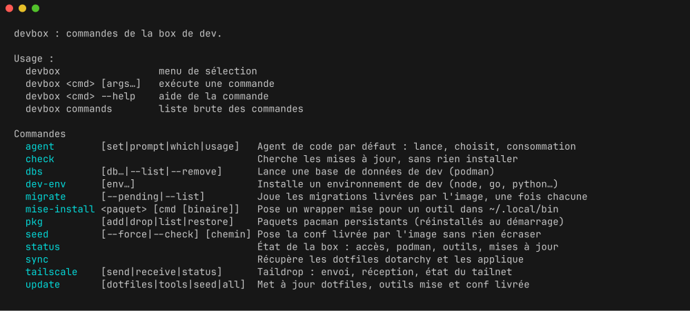

# The devbox command

`devbox` is the front door to everything the box can do. It is modelled on the
`omarchy` command of the Omarchy desktop, in a much smaller shape.

```bash
devbox                 # menu of commands, pick one and it runs
devbox status          # what the box is doing right now
devbox update tools    # run a command with its arguments
devbox seed --help     # summary, usage, then the command's own help
devbox --help          # usage and the table of commands
devbox help            # step by step help, picked in a list (`devbox help ios`)
devbox commands        # bare list, one name per line, for completions
```



## The commands

| `devbox` | Binary | Does |
| --- | --- | --- |
| `status` | `dev-box-status` | image commit and repo, Tailscale or sshd, podman, GPU, mise tools, pending updates |
| `gpu` | `dev-box-gpu` | the GPU of the host: state, `install` and `remove` of its drivers, `test` (a hardware encode against the CPU); see [gpu.md](gpu.md) |
| `check` | `dev-box-check-updates` | look for what could be updated, install nothing; `--image` says whether the image is the latest |
| `update` | `dev-box-update` | `dotfiles`, `tools`, `seed`, or all of them |
| `seed` | `dev-box-seed` | lay down the config shipped by the image |
| `override` | `dev-box-override` | what this box changes from the image defaults, and how to undo it; `--diff [path]` shows the changes in the files |
| `sync` | `dotarchy-sync` | pull the dotfiles and apply them |
| `dev-env` | `dev-box-dev-env` | install or remove a dev environment with mise |
| `tui` | `dev-box-tui` | install or remove terminal apps from a catalogue (btop, lazydocker, atac, ...) |
| `dbs` | `dev-box-dbs` | start a development database in a podman container |
| `diagnostic` | `dev-box-diagnostic` | starts your coding agent on the box's diagnostic guide: gathers facts with read-only commands, says what is wrong, asks before changing anything; `--report` prints the facts without an agent, to paste to someone |
| `agent` | `dev-box-agent` | the default coding agent: run it, pick it, read its usage |
| `motd` | `dev-box-motd` | the login line: one command drawn at random, pending updates |
| `changelog` | `dev-box-changelog` | what changed in the box, newest first; the 3 latest, `-n N`, `--all`, `--upcoming` for what the next image brings |
| `tour` | `dev-box-tour` | a guided tour of the box, two minutes, commands run under your eyes |
| `desktop` | `dev-box-desktop` | the graphical session of `devbox dev-env desktop`, reached with gliff, started at connection and stopped by hand: a menu without an argument, `status`, `start`, `stop`, and its graphical apps (VS Code, Chromium): `apps`, `install`, `remove`, `open` |
| `help` | `dev-box-help` | step by step help for what a command cannot do alone: without a topic, a list to pick from; `--list`, `--check` |
| `migrate` | `dev-box-migrate` | run the migrations shipped by the image, once each |
| `mise-install` | `dev-box-mise-install` | write a mise-backed wrapper into `~/.local/bin` |
| `pkg` | `dev-box-pkg` | pacman packages that survive an image rebuild |
| `serve` | `dev-box-serve` | publish a local port to the tailnet with `tailscale serve` |
| `tailscale` | `dev-box-tailscale` | Taildrop send and receive, Taildrive shares, tailnet status |

Where each one is described in detail:

- `status`, `check`, `update`, `migrate`, `changelog`: [updates.md](updates.md)
- `seed`, `sync`, `override`, `mise-install`: [customization.md](customization.md)
- `dev-env`, `desktop`: [dev-envs.md](dev-envs.md)
- `tui`, `pkg`: [tools.md](tools.md)
- `dbs`: [databases.md](databases.md)
- `agent`: [agents.md](agents.md)
- `diagnostic`: [troubleshooting.md](troubleshooting.md)
- `serve`, `tailscale`: [access.md](access.md)
- `tour`, `motd`, `help`: below

In the box, the `devbox` skill carries the same reference for coding agents,
in more detail:
[`commands.md`](../rootfs/usr/share/devbox/skills/devbox/commands.md).

## How it finds its commands

There is no hardcoded list. `devbox` scans the executables of `/usr/local/bin`
and reads a comment header at the top of each one:

```bash
# devbox:name=update
# devbox:summary=Update dotfiles, mise tools and the shipped config
# devbox:summary.fr=Mettre à jour les dotfiles, les outils mise et la config livrée
# devbox:args=[dotfiles|tools|seed|all]
# devbox:hidden=true    # optional: out of the menu and the list, still routable
# devbox:requires=tailscale   # optional: hidden too while that feature is off
```

Adding a command therefore means dropping a `dev-box-<name>` script in
`rootfs/usr/local/bin/` with those three lines. Nothing to register anywhere.

Every one of them keeps its own name on `PATH`, so `dev-box-update dotfiles`
and `devbox update dotfiles` are the same thing. The scripts and the
entrypoint call the binaries directly. `dev-box-podman` carries `hidden=true`:
it is the wrapper behind the `docker` and `podman` symlinks, not a command you
call. `dev-box-tailscale` and `dev-box-serve` carry `requires=tailscale`: with
`TS_DISABLE=true` they leave the menu and the list, but `devbox tailscale` and
`devbox serve` still answer, with the reason.

The `summary.fr` line is the French summary, shown instead of the English one
when `LANG` is French (`LANG=fr_FR.UTF-8` in `.env`); a command without one
keeps its English summary. The summaries and the login tips are the only
translated texts, see [Language](customization.md#language).

## Menus

Without arguments, `devbox` opens a gum menu listing the commands with their
summary, and runs the one you pick. Every command with subcommands then opens a
menu of its own when it has a terminal and no argument: `pkg`, `mise-install`,
`tailscale`, `serve`, `update`, `migrate`, `seed`, `dbs`, `dev-env`, `tui` and
`agent` all ask what to do, then ask for what they need (a package name, a
port, a machine, a file) with gum. The whole tree is navigable without
remembering an argument. With no terminal nothing asks: the command runs its
default action when it has one (`update` updates everything, `migrate` and
`seed` apply) and prints its usage otherwise, so scripts and the entrypoint
behave as before.

## The first login, and the tour

The first time a shell opens in a new box, gum asks whether to take the tour:
seventeen steps at most, two minutes, each one explaining one thing about the box
and offering to run the real command right there (`devbox status`,
`devbox dev-env --list`, `devbox tui --list`, `devbox agent set`,
`devbox help --list`, and so on).
The databases step only shows when podman is on, the tailnet step only with
Tailscale, and the steps about the overrides and about changing the box print
links to the matching pages of the repository the image was built from.
Decline and it never asks again; `devbox tour` plays it any time,
`devbox tour --text` prints it at once.

The entrypoint writes `~/.config/dev-box/tour-pending` on a brand new home, the
login script hands it to `dev-box-tour --offer`, which removes the flag before
asking, so a closed terminal does not bring the question back. Homes created
before the tour existed get the flag once, through a migration.

## Step by step help

Some things a command cannot do for you: sign in to an account, download a
file behind a login, plug a cable, edit a file on the host. `devbox help`
holds the steps for those, one topic each.

```bash
devbox help            # pick a topic in a list; the list itself without a terminal
devbox help ios        # one topic
devbox help --list     # the topics, one per line with their title
devbox help --check    # hold every topic to the layout
```

| Topic | Steps for |
| --- | --- |
| `ios` | what is left to you after `devbox dev-env ios`: Xcode and `xtool setup`, the device, a first app, a newer Swift |
| `ios-usb` | an iPhone or iPad plugged into your machine while the box runs on another |
| `gpu` | giving `/dev/dri` to the box on the host, then the drivers and the test |
| `desktop` | a graphical session of the box shown by gliff: the GPU, `devbox dev-env desktop`, connecting, the keys, stopping it |
| `podman` | turning docker and podman on: the override block, `PODMAN_ENABLE`, the restart |
| `tailscale` | moving a box reached over plain SSH to Tailscale: `.env`, attaching the node, the policy, what it opens |
| `image` | taking a new image on the host, and what to do before and after in the box |
| `backup` | `scripts/backup.sh` and `scripts/restore.sh` on the host |

On a terminal, a topic longer than the screen opens in `less`.

Every topic has the same layout, the way every dev environment has the same
functions: a title on the first line, an optional introduction, numbered steps
that say where they happen (on the host, in the box), then optional sections,
`Sources` last. Text is indented by 5 and commands by 7, in 78 columns of
ASCII. The whole contract is at the top of `/usr/share/devbox/lib/help.sh`,
and `devbox help --check` says which line of which topic breaks it.

A file of the same layout in `~/.config/dev-box/help/<topic>.txt` adds a topic
to your box, or replaces the image's one of the same name; `--list` marks it.
`devbox --help` remains the usage and the table of commands.

## The login message

Landing in the box prints one line, once per tmux session and once per shell
outside tmux: a command of the box drawn at random, and what it does. A second
line, in yellow, appears when an update is waiting, and another one while the
`DEV_ENVS` environments of `.env` are still installing, or when they failed, and
a warning while the graphical session of `devbox desktop` is running. It
is `devbox motd`. It reads nothing but the box itself, no network and no cache,
and costs a few milliseconds.

```
Tips: devbox dbs postgres redis  start these databases, data kept in a volume
2 updates available, run devbox update
```

The commands come from the `TIPS` list at the top of the script, drawn with
`shuf`; the ones that need Tailscale stay out when `TS_DISABLE=true`. With
`LANG=fr_FR.UTF-8` the text of the tip comes from
`/usr/share/devbox/motd/tips.fr`, keyed by the command, English when a tip has
no translation there. The
updates line folds `~/.cache/dev-box/updates` into a count; the detail of what
is waiting stays in `devbox check` and `devbox status`. The `DEV_ENVS` line is
`~/.cache/dev-box/dev-envs`, written by the entrypoint and removed once every
environment is installed. Everything else, the box, its commands and where the
coding accounts stand, is one command away: `devbox`, `devbox status` and
`devbox agent usage`.

The first login after an update starts with what changed, see
[updates.md](updates.md#the-changelog-at-login).
