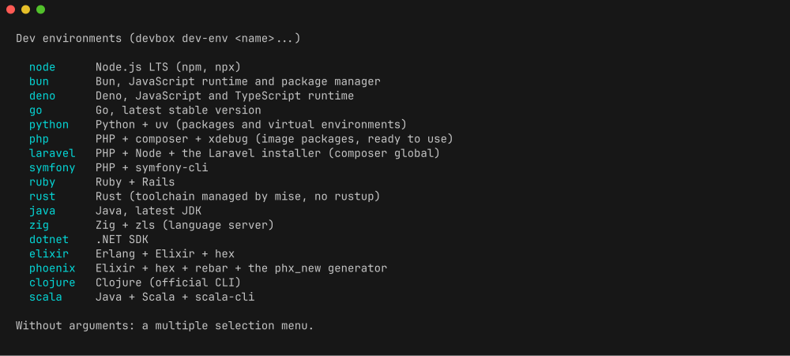
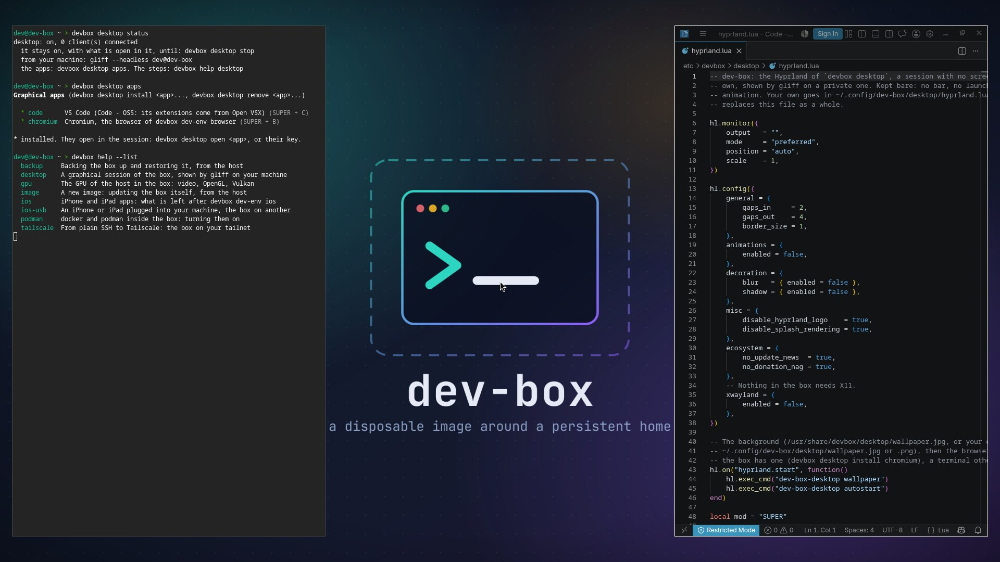

# Dev environments

`devbox dev-env` installs or removes a whole language environment in one call,
through mise. No `curl | sh`, and no pacman except for PHP, the browser,
media, network and one library for Swift (see below). The GPU drivers have their own command,
`devbox gpu` (see [gpu.md](gpu.md)). Whatever mise installs is declared in
`~/.config/mise/config.toml`, survives a rebuild, and is upgraded by
`devbox update tools` like the rest.

```bash
devbox dev-env --list             # what is on offer, and what is installed
devbox dev-env --info ruby        # what one installs, and what a removal leaves
devbox dev-env node go            # install these two
devbox dev-env --remove node go   # remove them
devbox dev-env                    # menu: install or remove, then several at a time
```



Without arguments it first asks whether to install or remove, then opens a gum
menu with multiple selection, the environments on the left and their
description on the right. The remove menu only offers what is installed.
Running it again on an environment already installed, or already removed,
changes nothing.

## `DEV_ENVS`: environments installed at start

The same environments can be asked for from `.env`: `DEV_ENVS="node go python"`
and every start makes sure they are there, through
`devbox dev-env --if-missing`, in the background after the mise tools. The
setup script asks for this list. What is installed already is
skipped, so a start only spends time on a fresh home or a name added since. An
unknown name refuses the whole list, nothing is installed. The output goes to
`~/.cache/dev-box/dev-envs.log`; while it runs, and when it failed, the login
message and `devbox status` say so on one line, and the line disappears once
everything is there.

`DEV_ENVS` never removes anything: take a name out of the list and the
environment stays until `devbox dev-env --remove`. The other way round, an
environment listed in `DEV_ENVS` cannot be removed, since the next start would
install it again: `devbox dev-env --remove` refuses it and the remove menu
leaves it out. Take it out of `.env` first, restart the container, then remove it.

## What a removal leaves

A removal takes the tools out of `~/.config/mise/config.toml` with
`mise unuse -g`, which also prunes the versions no other config needs. It only
removes what the environment itself brought: `laravel` drops the installer but
keeps PHP and Node, `phoenix` drops the `phx_new` archive but keeps Elixir,
`scala` keeps Java, `db-clients` and `ansible` keep Python, and the message
says how to remove the base. Project data
is never touched: `~/go`, `~/.cargo`, `~/.mix`, `~/.m2`, `~/.config/composer`
and the like stay where they are, so a later `devbox dev-env <name>` finds
everything back.

## Environments that do more

A few of them do more than pull a runtime. `python` also installs `uv`. `ruby`
writes `~/.gemrc`, turns off `ruby.compile` so mise takes a precompiled build
instead of spending minutes on a compiler, and installs Rails. `elixir` runs
`mix local.hex`, and `phoenix` adds rebar and the `phx_new` generator. `rust`
is the mise toolchain, not rustup, so there is a single place where versions
are declared.

`db-clients` adds the database shells that go with `devbox dbs` (see
[databases.md](databases.md)), through mise: `mongosh`, `usql` (one shell for
PostgreSQL, MySQL, SQLite, SQL Server and more), and `mycli` and `litecli`
from PyPI, which is why it installs `python` first. `psql` and `mariadb` (or
`mysql`) are not in it: they are in the image. `pgcli` is not in it either: it
is in `devbox tui`.

`ansible` installs `python` first, then `ansible-core` and `ansible-lint` from
PyPI through mise. `ansible-core` only has the builtin modules:
`ansible-galaxy collection install community.general` adds the usual ones, in
`~/.ansible`, which a removal leaves in place. The box is the control node,
the targets are other machines over SSH (VMs, the lab, the tailnet), or the
box's own containers once podman is on.

`android` is the platform-tools only, `adb` and `fastboot`, taken from the zip
Google publishes, through mise's http backend: no SDK manager, no platform, no
Java. That URL carries no version, so `devbox update tools` cannot refresh it;
run `devbox dev-env android` again to take the latest build. The zip also
carries an old `sqlite3`, which the command removes so that the one of the
image stays first on the PATH. Google publishes no arm64 build, so on an arm64
box the command points to `devbox pkg add android-tools` instead.

`android-sdk` is the full SDK, to build apps: the cmdline-tools from the mise
registry, pinned to the version of the day so that `devbox update tools` never
moves `ANDROID_HOME`, then `sdkmanager` lays the platform-tools, the newest
stable platform and build-tools inside it, the licenses accepted on your
behalf. It needs a JDK 17 or 21: `java@temurin-21` when no java is declared,
the declared one otherwise. There is no emulator (no KVM, no display): deploy
to a phone over USB or `adb connect`. `flutter` sits on it, from the official
stable archive through mise, with the Android and web engine artifacts fetched
at install and Linux desktop turned off; the web target runs with
`flutter run -d web-server --web-hostname 0.0.0.0`. Both are x86_64 only,
Google publishes no arm64 build-tools.

`swift` is the toolchain of swift.org, which publishes no build for Arch: mise
takes the Red Hat UBI 9 one, and the environment gives it the two things Arch
no longer has. `libxml2.so.2` comes from the `libxml2-legacy` package, through
`devbox pkg`. The ncurses libraries without wide characters are links to the
wide ones of the image, laid inside the toolchain itself, where its binaries
look before the system: nothing is added to `/usr`, and no `LD_LIBRARY_PATH`
is set. A version `devbox update tools` installed would come without those
links, so the version is pinned to the one of the day; remove the environment
and install it again to move to a newer Swift. `lldb` does not start: it wants
the Python 3.9 of UBI 9.

`ios` builds iPhone and iPad apps without a Mac. It sits on `swift` and
`python` and adds [xtool](https://github.com/xtool-org/xtool), which builds,
signs and installs a SwiftPM app, and `pymobiledevice3`, which talks to the
device. xtool is an AppImage and the box has no FUSE to mount one, so
`APPIMAGE_EXTRACT_AND_RUN=1` goes into the mise config with it. One step is
left to you, since it takes your Apple account: `xtool setup` signs in and
builds the iOS SDK from an `Xcode.xip` downloaded from developer.apple.com.
There is no simulator: an app runs on a real device, plugged into the host
and given to the box by the USB block of `compose.override.example.yaml`, with
`devbox pkg add usbmuxd` and `sudo usbmuxd` in the box. The install ends on
those steps, one by one (the Xcode download and `xtool setup`, the device,
`xtool new` and `xtool dev` for a first app, what to answer on the device,
moving to a newer Swift), and `devbox help ios` shows them again.

When the box runs on a remote machine and the device is on your desk, the USB
block is of no use: the usbmuxd of your own machine does the USB part, and the
box reaches it through SSH. Nothing goes into the compose file and no usbmuxd
runs in the box.

```bash
ssh -R 27015:/var/run/usbmuxd <user>@<box>       # from your machine, device plugged in
export USBMUXD_SOCKET_ADDRESS=127.0.0.1:27015    # in the box, in that session
xtool devices
```

`devbox help ios-usb` has the whole of it, checked as far as xtool opening
that address, not yet with a device at the other end: what your machine needs, what to do
when the SSH connection refuses the forward, and the other ways. `ios` also makes the
`lldb` of the toolchain work: it takes the Python 3.9 lldb was built against
as a mise tool of its own (`http:lldb-python`, pinned with its sha256, no
command on the PATH, the default python untouched) and starts `lldb` and
`lldb-dap` through a launcher that sets `PYTHONHOME` for them alone. Both are
x86_64 only.

`desktop` gives the box a graphical session, for a browser or any window,
shown on your machine by [gliff](https://github.com/omacom/gliff) through the
ssh connection you already have. It is off by design, installed or not:
nothing runs until a gliff client connects, and the session starts with it, on
a private screen sized to the client's window. It then stays, with what is
open in it, until `devbox desktop stop`: closing gliff or losing the link
leaves it as it is, and nothing stops it on its own, so nothing open is lost.
It holds about 270 MB of memory while it is on, so the box keeps it in sight:
the status line of tmux shows `desktop on` and the login message warns about it
until it is stopped.



```bash
devbox desktop                    # in the box: the menu, which first offers to enable it
devbox desktop enable             # the same without a menu (or devbox dev-env desktop); needs the GPU
devbox desktop install code       # VS Code in it; chromium for a browser
gliff --headless dev@dev-box      # from your machine: the session starts
devbox desktop stop               # stop it, with every window in it
```

The apps are not part of the environment. `devbox desktop apps` lists the ones
on offer, `devbox desktop install <app>` and `remove <app>` go through
`devbox pkg`, so an app comes back after a rebuild: `code` (VS Code as Arch
packages it, Code - OSS, whose extensions come from Open VSX) and `chromium`
(with `noto-fonts`, the same browser as `devbox dev-env browser`). Both start
with `--no-sandbox`, since a container refuses the namespaces their sandbox
wants. In the session `SUPER + C` and `SUPER + B` open them, and from a shell
`devbox desktop open <app>`.

A gliff client runs `gliff-server` over ssh. In the box that name is a
launcher of the image, which starts the session when it is not there, then
hands over to the real `gliff-server`: a mise tool (`http:gliff`, the package
of the Omarchy repository, pinned with its sha256, nothing on the PATH). The
session is a Hyprland nested in a labwc that has no screen, since Hyprland
does not start without one; both come through `devbox pkg`, with `foot`,
`swaybg` and `libva`. Hyprland needs the GPU of the host in the box
(`/dev/dri`) and does not start without it. It reads
`/etc/devbox/desktop/hyprland.lua`, bare on purpose and in the Lua format
Hyprland is moving to, or your own `~/.config/dev-box/desktop/hyprland.lua`.
The background is `/usr/share/devbox/desktop/wallpaper.jpg`, or your own
`~/.config/dev-box/desktop/wallpaper.jpg` (or `.png`). The session opens
Chromium when the box has it, a terminal otherwise. x86_64 only, the one it was tried on, with the test client of gliff
through a real ssh connection; Tailscale SSH with the key of a client is not
tried yet. `devbox help desktop` has the steps and the keys.

## The exceptions: PHP, browser, media, network

PHP is the one exception. mise can only build PHP from source, which takes
minutes and needs a pile of development headers, so `php`, `composer`,
`php-sqlite`, `php-gd`, `php-sodium` and `xdebug` are pacman packages baked
into the image, with the usual extensions and xdebug already enabled at build
time. `devbox dev-env php` only checks and shows what is there. `laravel` adds
Node and the Laravel installer through `composer global`, kept in
`~/.config/composer`, which is in the PATH and in the persistent home.
`symfony` adds `symfony-cli` through mise's github backend.

`browser` is the other exception: a headless Chromium, with `noto-fonts` so
that emojis and non Latin scripts do not render as squares, so that a coding
agent can look at a dev server and check the result. The builds Playwright and
Puppeteer download target Debian and Ubuntu and still need a pile of pacman
libraries, so the environment installs the distribution package through
`devbox pkg add chromium noto-fonts` instead: it works as it is on amd64 and on
Arch Linux ARM, and `devbox pkg` reinstalls it after a rebuild. Chromium is not
baked into the image because it weighs about half a gigabyte and most boxes
never need it.

It also adds [agent-browser](https://github.com/vercel-labs/agent-browser)
through mise, a single binary made for coding agents: `agent-browser open`,
`snapshot` (the accessibility tree, with a ref per element), `click`, `fill`,
`screenshot`, `eval`, one command per step, with no script to write and no
`npm install`. `~/.agent-browser/config.json` points it at the system Chromium
(created when missing, completed when it has no `executablePath`, left alone
when it names another browser), so it never downloads one. How an agent uses
all of it, and Playwright or Puppeteer on the system Chromium when a project
needs them, is in the
[`browser.md`](../rootfs/usr/share/devbox/skills/devbox/browser.md) guide of
the agent skill. A box that installed `browser` before gets `agent-browser`
with `devbox dev-env browser` again, or at the next start when `DEV_ENVS` has
`browser`.

`media` gathers the tools to fetch, convert and inspect audio, video and
pictures. `yt-dlp` and `oxipng` come through mise, so `devbox update tools`
keeps `yt-dlp` current: it breaks whenever a site changes. The rest goes
through `devbox pkg`, like the browser: `ffmpeg` (the mise registry only builds
it from source), `pngquant`, `jpegoptim`, `cwebp` (`libwebp-utils`),
`exiftool`, `mediainfo` and `aria2`. `ffmpeg` stays out of the image for its
size; once there, yazi shows video thumbnails. YouTube wants a JavaScript
runtime for `yt-dlp`: `devbox dev-env deno`. A removal takes everything out,
`ffmpeg` included.

`network` gathers the tools of a SISR network course: `nmap`, `tcpdump`,
`iperf3`, `mtr`, `socat`, `ethtool` and `ipcalc` through `devbox pkg` (the
mise registry has none of them), and `doggo`, a DNS client with a readable
output, through mise. The small basics are in the image already, with no
environment: `dig`, `nslookup` and `host`, `nc`, `whois`, `traceroute`,
`ping`, `ip` and `ss`. `devbox tui` has `trippy`, `gping` and `termshark` on
top. The box runs with `NET_RAW` and `NET_ADMIN` (Tailscale needs them) and
`sudo` asks no password, so `sudo nmap -sS` and `sudo tcpdump -i any` work;
without `sudo`, nmap falls back to a connect scan. The box is still a
container: `tcpdump` only sees its own interfaces, not the traffic of the host
or the LAN, and the LAN is reached through the NAT of Docker, so an ARP scan
never shows the real MAC addresses. A removal takes out what the environment
brought and leaves the image's tools.

OCaml is not offered: upstream it goes through the opam installer, which would
be wiped by the next image rebuild.

## How an environment is written

Each environment is a short script with three functions, `details`, `install`
and `uninstall`, plus `is_installed` when the mise config cannot tell and
`is_supported` when it does not run everywhere, and `is_hidden` for an alias
kept out of the menu and the list but still installed by name and by
`DEV_ENVS` (`gpu`, now `devbox gpu install`). What this machine cannot take
(`android`, `android-sdk`, `flutter`, `swift`, `ios` and `desktop` on arm64, `desktop` in a box without a GPU) is left out of the menu and
the list, and skipped by `DEV_ENVS`, so one `.env` serves both architectures.
The image ships them in `/usr/share/devbox/dev-envs/`, and `devbox dev-env`
finds every file there on its own.

A script of the same shape in `~/.config/dev-box/dev-envs/<name>.sh` adds an
environment to your box, or replaces the image's one of the same name, and
survives rebuilds since it lives in the home; `--list` marks it. The format is
described at the top of `/usr/share/devbox/lib/dev-env.sh`, and copying one of
the image's scripts is the quickest start. To ship one in the image for every
box, see
[`extending.md`](../rootfs/usr/share/devbox/skills/devbox/extending.md).
